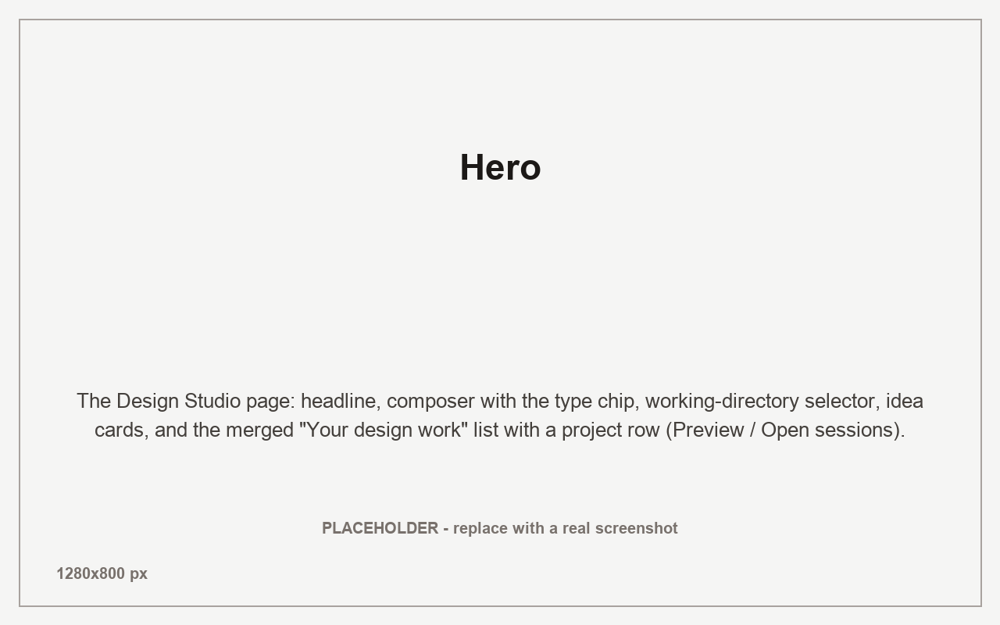
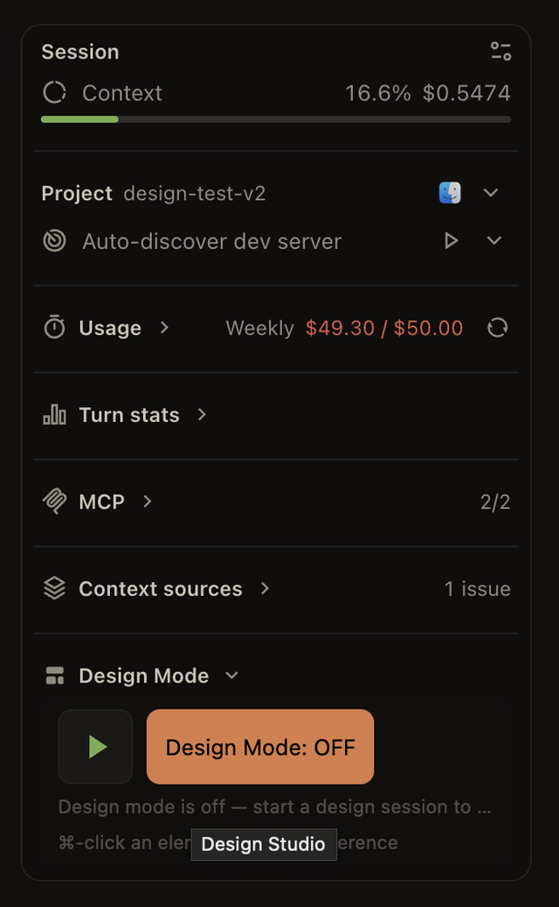
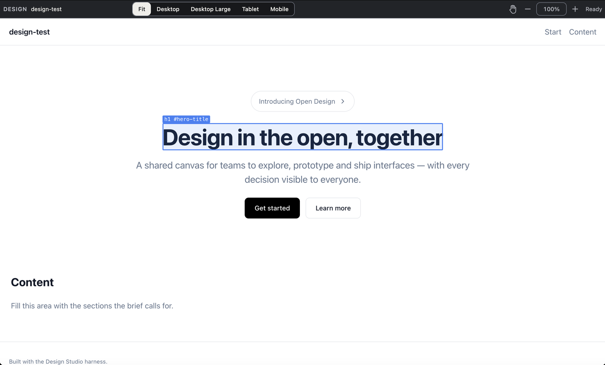

# OpenChamber Design Studio

An extension for OpenChamber — an **open, local alternative to Claude Design**.
Design work happens inside the chat: you keep a live browser preview of your own
running app beside the conversation, point at what you want changed, and the
agent edits the real project while you watch.

[](LICENSE)
[](package.json)
[](https://github.com/lastonoga/openchamber-design-studio/actions/workflows/ci.yml)



## What this is for

Design work in Claude Design means the screens live in someone else's product:
you generate artboards there, and your actual application is somewhere else.
Later you export them and try to make the real code match.

OpenChamber Design Studio is the **open, local counterpart to Claude Design**.
It runs inside OpenChamber, opens a real Chrome window at your own dev server,
and lets you point at what you want changed while the agent edits the real
project in your repository. Your work is never uploaded, no vendor canvas holds
it, and the model is whichever one your OpenChamber setup already uses.

| | Claude Design | OpenChamber Design Studio |
| --- | --- | --- |
| Where the screens live | In the vendor's product, on their canvas | In your project on disk, in your git repo |
| What you are editing | Artboards generated inside that canvas | Your real running app, through a real Chrome window |
| Who does the editing | The vendor's model, inside their product | Your agent and your model, in your OpenChamber session |
| Getting the work out | Export, then reconcile by hand | Nothing was uploaded — it is already a commit |
| Source | Vendor-hosted, closed | Open source (MIT), runs locally |

The comparison is qualitative and, deliberately, the difference that matters is
structural rather than a feature count: local, open and on your own app. Claude
Design moves fast, so treat the left column as "as of 2026-10-14".

To be precise about lineage: this is not a wrapper around
[OpenDesign](https://github.com/nexu-io/open-design). Its design-system presets
are vendored from it under the Apache License 2.0 — nothing else is shared, and
the harness, the browser bridge and the chat integration are this project's own.

Where it stands today: point at an element, type what should change, and the
agent edits the project while the preview reloads. That loop is implemented.

## Install

OpenChamber Design Studio installs through **Settings → Extensions** in
OpenChamber, which accepts either of the following:

- **Git install.** Paste the repository's https git URL. Settings → Extensions
  compares the installed `package.json` `version` with the origin and offers
  **Update** when the origin is newer, so shipping a change means bumping
  `version`; a `#tag` or `#branch` suffix on the URL pins that channel.
- **Folder install (local development).** Paste an absolute path to this
  repository. Settings stores the realpath and marks the source as a local
  folder.

Before the extension can open a preview, approve its local **service** permission
once in Settings → Extensions. That consent step is a one-time user decision, not
a setting the extension can grant itself.

Requirements:

- **OpenChamber ≥ 2.2.0** (the manifest declares `engines.openchamber` as
  `>=2.2.0`).
- **Google Chrome** installed (the local service launches it). The default path is
  macOS `"/Applications/Google Chrome.app/Contents/MacOS/Google Chrome"`;
  `DS_CHROME_PATH` overrides it.
- Approval of the extension's local **service** permission, once.

Working on the extension itself:

```bash
npm install
npm run build      # writes panel/main.js (IIFE) and service/main.js (Node ESM)
npm run check      # typecheck + tests + build
```

`panel/main.js` and `service/main.js` are committed to the repository, because
OpenChamber never compiles extension code — it loads the built files as they are.

## Features

### Design Mode lives in the chat

Design Mode turns a chat session into a design session. It is toggled by the
slash command `/design [on|off|<type>]` and mirrored in the chat's **Work Status**
section as a compact row with the Start/Stop control, the Design Mode toggle and
the session status. The mode is per-session and persisted in host storage, so a
session that was started as a design session reopens with the widget on.

**Mini chat.** Run `/design` inside a mini-chat window and it starts the design
session for that chat: the live Chrome window opens and the project reference
chip lands in the mini composer. Picked-element chips currently attach through
the main window's Work Status row (the host force-recycles hidden extension
frames after 20 seconds, so a mini-chat pick bridge needs a host-side
persistent surface there — tracked upstream).



### A live preview you can point at

The preview is not a canvas drawn into a panel. It is a **real, chromeless Chrome
window** — a headful `--app` window opened in incognito with extensions off and a
throwaway profile — driven over the DevTools Protocol by the extension's local
service. `POST /open` launches or navigates it, `/focus` raises it without
reloading, and `/stat` reports file change stats so the preview can reload when the
agent edits a file. Because it is a real browser, your React/Vite dev server runs
and hot-reloads exactly as it does outside OpenChamber.



### Pick an element, get a chat reference

Hold ⌘ (Ctrl on Windows/Linux) and click any element in the live window. The click
is treated as a pick rather than a normal click, and the element becomes a
reference chip on the chat composer via `host.attach` — carrying its CSS selector,
outer markup, computed styles and the page URL. The chip's text reaches the model;
its `data` payload is echoed back byte-for-byte to the extension. Hovering a
reference row briefly re-flashes the matching element in the live window.

Picks attach through the chat whose Work Status row is bound to the live
window (the main window). Pick feedback composites above the page's own
modals and dialogs, and elements inside shadow DOM resolve to the element you
actually clicked.

### The harness runs inside your project

When Design Mode turns on for a project, the extension writes a project-local
OpenCode plugin to `.opencode/plugin/design-studio-harness.ts`. OpenCode discovers
and loads `.opencode/plugin/*.ts` into every session for that project, so the
harness — designer identity, design-system authority, the craft rulebook and the
verification protocol — reaches the model on every turn, not only when the
extension composes a prompt. The generated file imports nothing and adds no
dependency; the extension never overwrites a file it did not generate, and writing
it is a deliberate, visible side effect.

### Design systems and presets

The workflow is built around a project's own **DESIGN.md** and **tokens.css**: when
present they are the authoritative design system and the model is told to follow
them over any conflicting instinct. Alongside that, the extension ships a vendored
catalog of **22 design-system presets** across 13 categories (Modern & Minimal,
Professional & Corporate, Developer Tools, and more) with a searchable preset
picker. A preset supplies semantic token values the scaffold and the harness can
build on.

### Project config and scaffolding

Each design project carries a `.design-studio.json` written by the agent, so the
preview opens the right URL with no setup from you. The extension reads it on open
(resolution order: `.design-studio.json`, then `design-studio.json`, then
`design/.design-studio.json`) and can edit it from the workspace. New projects can
be scaffolded directly: `POST /scaffold` lays down a Vite skeleton, picks a free
loopback dev-server port from the range 5200–5999 (starting at a random offset so
parallel inits rarely collide), starts the dev server and writes the harness
plugin — before the agent session even starts.

### What it produces

Design sessions target one of several types — a wireframe, hi-fi screens, an
interactive prototype or a presentation deck — and the merged **Your design work**
list on the creation page keeps every registered design project and design chat in
one place, each row told apart by a small type icon.

## Configuration and requested permissions

When you approve the extension you are approving a specific, bounded surface. In
the manifest:

- **Declared capabilities: `prompt` and `sessions`.** `prompt` lets the extension
  compose or send on the current session; `sessions` covers session lists,
  subscriptions and opening sessions.
- **Service capability: `provides: ["browser"]`.** This exposes the extension's
  local service to OpenChamber's browser provider, which is how the agent gets
  deterministic stills and drives the same window.

The service is plain about what it is: a loopback HTTP server that binds
`127.0.0.1` and requires an `Authorization: Bearer <token>` header on **every**
request, including `/health`. It launches and drives a real Chrome window with
your own user rights — the same rights the service itself runs with. It is not
sandboxed from your machine, and it reads and writes files inside the design
project it is pointed at.

## Compatibility

- **OpenChamber:** `engines.openchamber >= 2.2.0`. Installation is refused when the
  running OpenChamber build is older.
- **Platform:** desktop and web only. VS Code and mobile mark the guest catalog
  `unsupported` and do not load the extension.
- **Browser:** a local Google Chrome. The default launch path is the macOS app
  bundle; set `DS_CHROME_PATH` to point at Chrome elsewhere. Other operating
  systems are not claimed beyond that override.

## Development

```bash
npm install
npm run build      # esbuild: panel/main.js (browser IIFE) + service/main.js (Node ESM)
npm run typecheck  # tsc --noEmit
npm run test       # node --test
npm run check      # typecheck + build + test
```

Layout:

- `panel/` — the sandboxed guest iframe: the creation page, the attach/workspace
  surfaces and the Work Status row. Built to `panel/main.js`.
- `service/` — the host-spawned local service: the real Chrome driver
  (`browser.ts`), dev-server management, scaffolding, project config, the harness
  plugin writer, and the verification harness (`verify.ts`, `gates/`). Built to
  `service/main.js`.
- `shared/` — code both sides import: the vendored design-system catalog, the
  harness rule text, and the verification types.

There are no pixel-baseline screenshots; verification is a set of deterministic
gates (overflow, tokens, accessibility, semantics, layout) run across the viewport
matrix.

## Contributing

Issues and pull requests are welcome. Please run `npm run check` before opening a
pull request, and keep the committed `panel/main.js` and `service/main.js` in sync
with their sources, since OpenChamber loads the built files directly. The CI
workflow at [`.github/workflows/ci.yml`](.github/workflows/ci.yml) runs typecheck,
build and the test suite with the Chrome-dependent integration tests excluded —
those need a local Google Chrome, so they are a local check, not a CI gate.

## License

MIT. See [`LICENSE`](LICENSE). Vendored design-system presets are redistributed
under the Apache License 2.0; see
[`THIRD_PARTY_NOTICES.md`](THIRD_PARTY_NOTICES.md).

OpenChamber Design Studio is a community extension. It is not affiliated with,
endorsed by, or maintained by the OpenChamber team.
